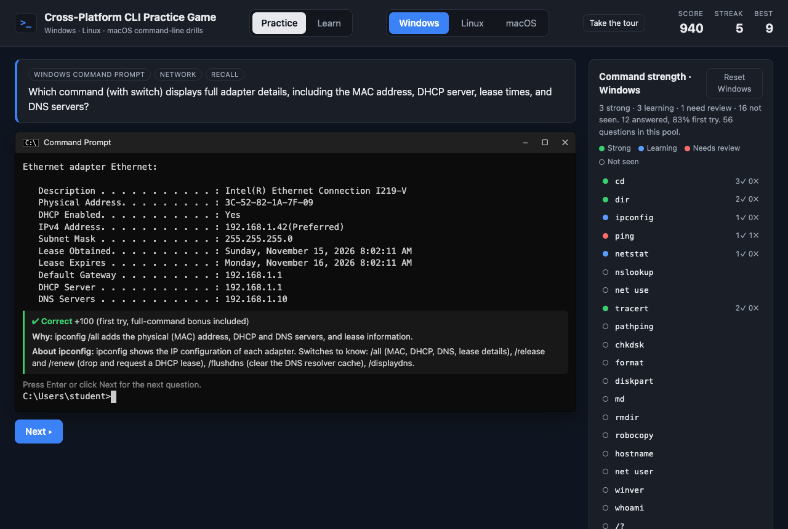
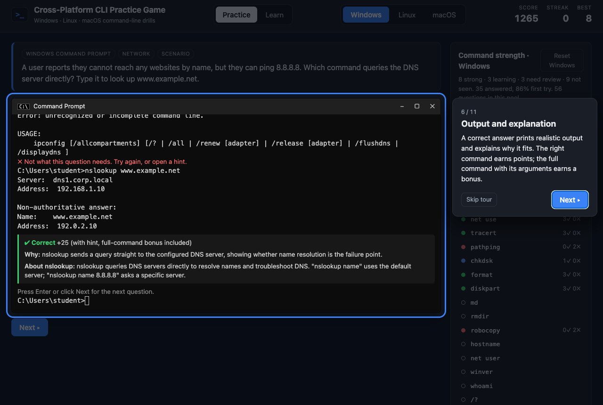
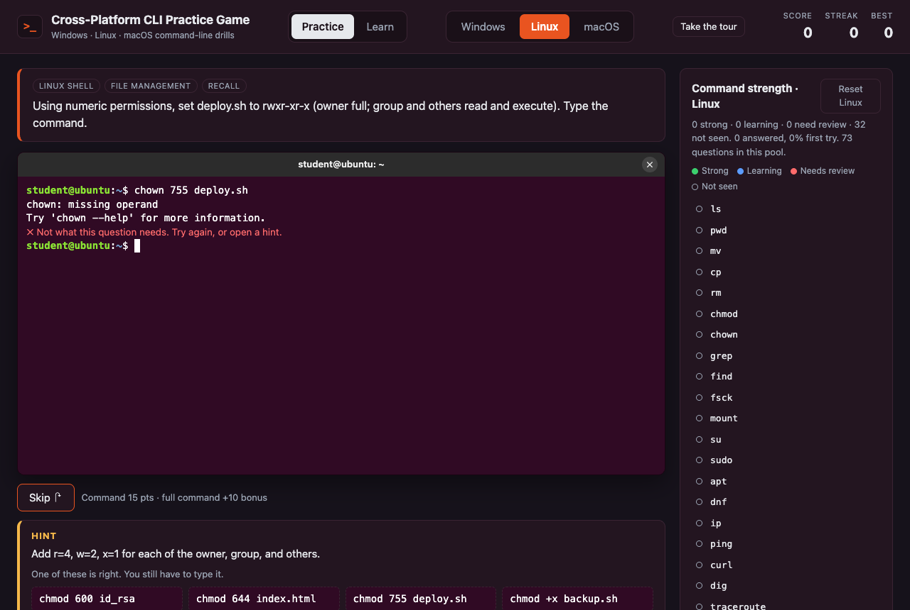
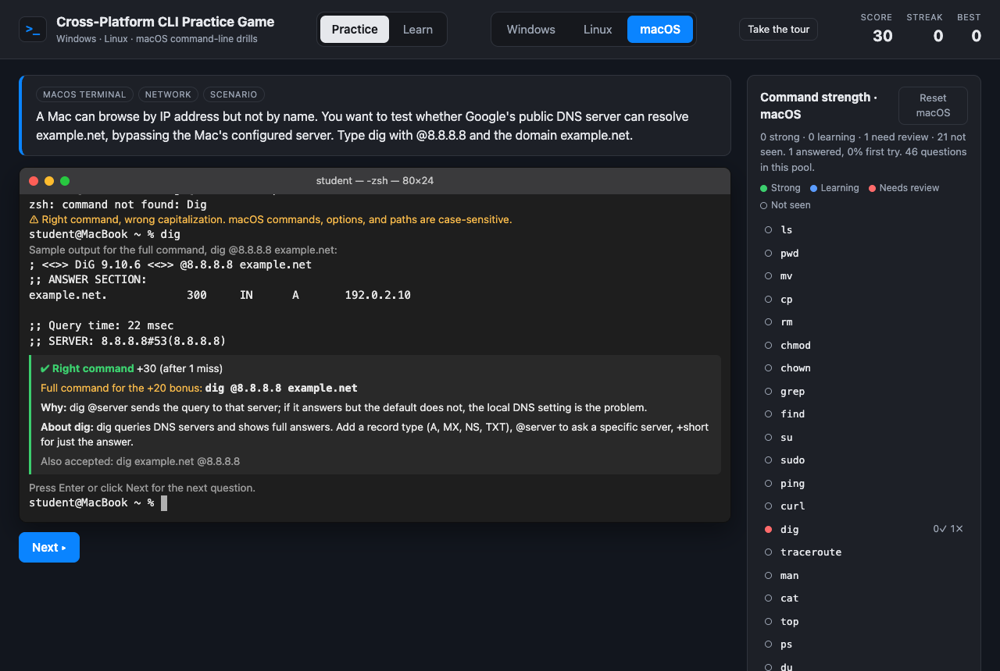
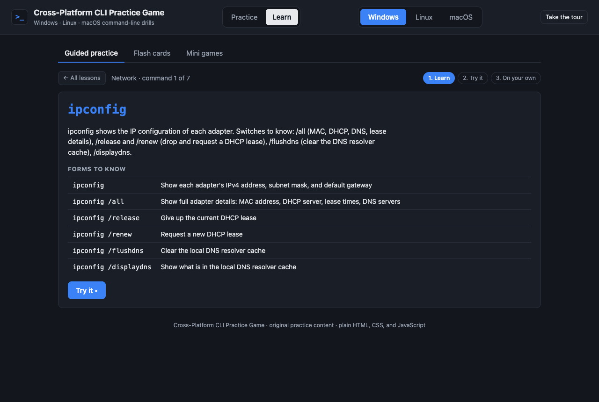
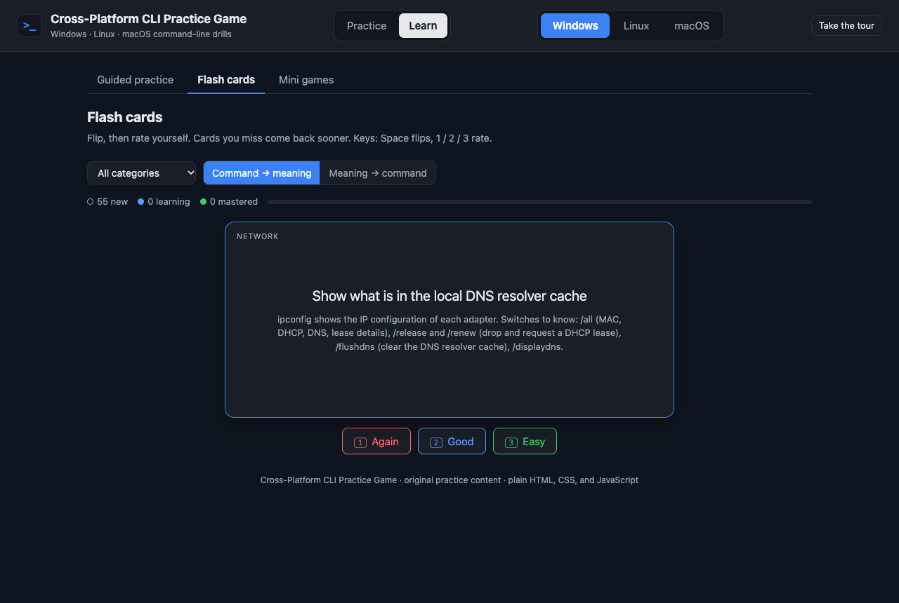
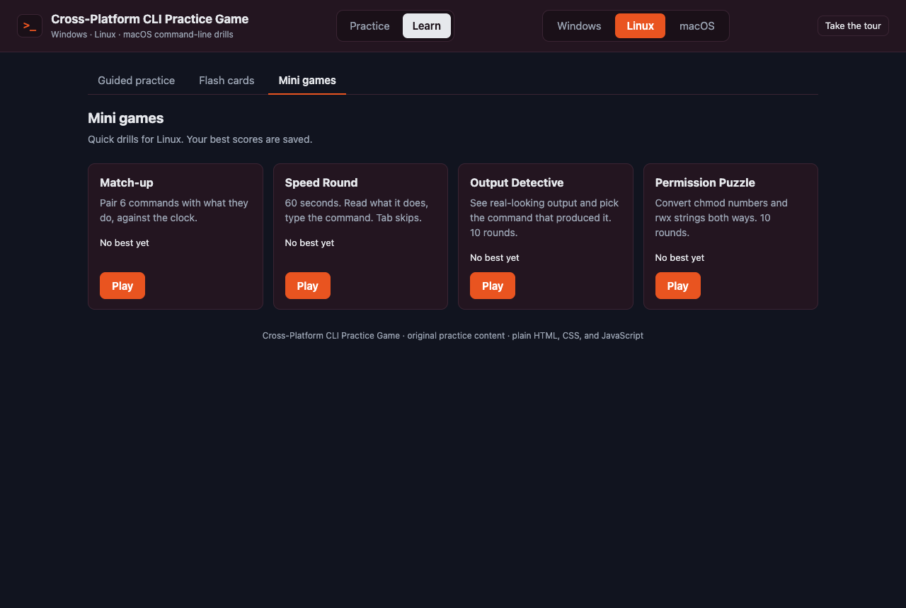
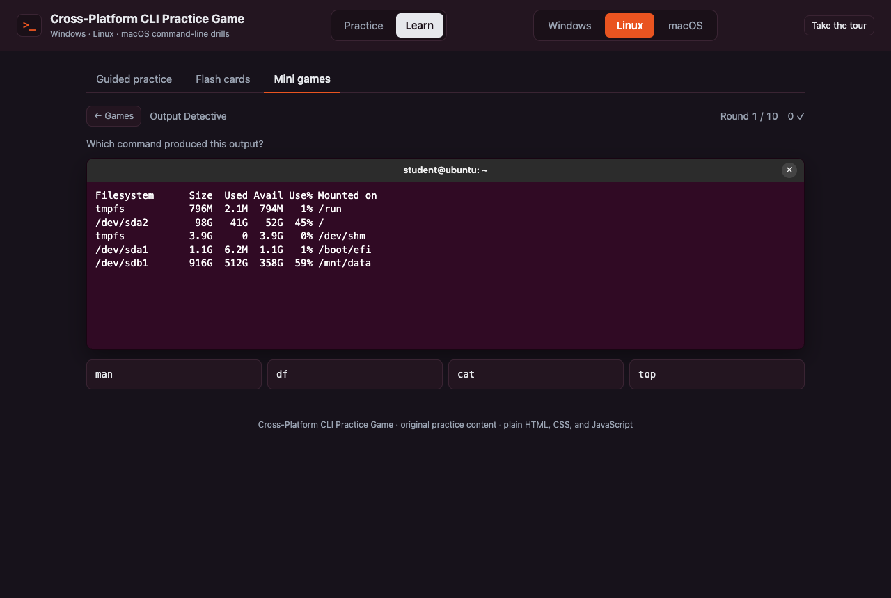

# Cross-Platform CLI Practice Game

A browser game for learning command-line tools on **Windows, Linux, and macOS** by actually typing them. Each OS gets its own simulated terminal, with the right prompt, realistic output, and believable errors. A Learn mode adds guided lessons, spaced-repetition flash cards, and four mini games.

**[▶ Play it](https://ss-bae.github.io/Cross-Platform-CLI/)** · **[Take the 1-minute guided demo](https://ss-bae.github.io/Cross-Platform-CLI/?demo)**

Built with plain HTML, CSS, and JavaScript: no framework, no build step, no server. It installs as an app and works offline.





## Features

### Practice mode
- **A terminal that feels like one.** Monospace font, blinking block cursor, focus that stays in the prompt, and up/down arrow history. Each OS has its own prompt and window style: `C:\Users\student>` in a Command Prompt window, `student@ubuntu:~$` in a GNOME-style window, `student@MacBook ~ %` with macOS traffic lights.
- **175 original questions** covering 23 Windows commands, 27 Linux commands plus 5 key `/etc` files, and 22 macOS Terminal commands. About half are troubleshooting scenarios and half are direct recall.
- **Realistic feedback.** A correct answer prints sample output plus an explanation. A wrong one prints the error that shell would give: `'foo' is not recognized…`, `ls: invalid option -- 'Z'`, `zsh: command not found: apt`, and so on.
- **Hints that don't give the answer away.** You get a one-line nudge and four candidate commands, but you still have to type the right one.
- **Scoring that rewards precision.** The right command earns points, and the complete command (switches and arguments) earns a bonus. Misses and hints reduce both.
- **Weak-spot review.** Commands you miss come back more often until you get them right three times without help. A per-OS strength panel shows where you stand.
- **Skip for later.** A skipped question returns after three others, tagged *Review*.

### Demo mode
Open the app with `?demo` for a self-running tour aimed at first-time visitors:
- **Sample progress is preloaded,** so the scores and the strength panel aren't empty.
- **An 11-step guided tour** spotlights each feature while the terminal types its own answers. It shows a realistic error, a hint, a correct answer, Linux's case rules, Learn mode, and the mini games.
- **A *Show me* button** types the answer for anyone who doesn't know the command. It's scored like a hint.
- **It's isolated:** demo progress lives in `sessionStorage` under its own keys, so it never touches a player's real progress and resets when the tab closes.

### Learn mode
- **Guided practice:** one lesson per topic. Each command goes *Learn* (what it does, plus a cheat sheet) → *Try it* (copy-type an example) → *On your own* (answer a scenario).
- **Flash cards:** 146 cards in both directions (command → meaning and meaning → command), with Leitner-box spaced repetition and keyboard controls.
- **Mini games:**
  - *Match-up:* pair commands with descriptions against the clock.
  - *Speed Round:* type as many commands as you can in 60 seconds.
  - *Output Detective:* identify which command produced a given output.
  - *Permission Puzzle:* convert `chmod` numbers ↔ `rwx` strings (Linux/macOS).

| Linux hint | macOS partial credit | Guided lesson |
|---|---|---|
|  |  |  |

| Flash cards | Mini games | Output Detective |
|---|---|---|
|  |  |  |

## Run it

Use the [live version](https://ss-bae.github.io/Cross-Platform-CLI/), or run it locally:

```bash
open index.html            # macOS; or double-click index.html on any OS
```

Everything runs from `file://`. Progress is saved in `localStorage`, separately for each OS, and each OS can be reset on its own.

### Install and offline
When served over HTTPS it's a progressive web app: a web app manifest with regular and maskable icons, plus a service worker (`sw.js`) that caches the app shell. Browsers offer to install it, and after the first visit it works with no connection. The service worker uses stale-while-revalidate, so each new deploy is picked up on the next load. From `file://` both are skipped, since browsers don't allow them there.

### Deployment
Every push to `main` runs the full test suite in GitHub Actions. If it passes, the workflow copies only the files the app serves into an artifact and deploys it to GitHub Pages (see `.github/workflows/ci.yml`).

## How it works

```
index.html            page shell; plain <script> tags so it works from file://
css/style.css         themes per OS via body[data-os] and CSS custom properties
data/questions.js     question bank: pure data (question, answers, hint, explanation, sample output)
data/learn.js         flash cards: pure data, also feeding Match-up and Speed Round
js/checker.js         answer checking: pure functions, shared by the browser and Node tests
js/app.js             demo flag, storage layer, demo sample data, service-worker registration
js/game.js            Practice mode: terminal, scoring, scheduling, persistence
js/learn.js           Learn mode: lessons, flash cards, mini games
js/demo.js            demo banner and guided tour
sw.js, manifest.webmanifest, icons/   installable, offline-capable web app
tests/                Node unit tests + headless-Chrome end-to-end suites
scripts/              regenerate README screenshots and app icons
```

### Design decisions
- **Content is data, not code.** Questions and cards are plain objects with a documented schema. Adding a question means adding one object; the tests then check it for coverage, duplicates, and hint leaks.
- **One checker, three rule sets.** `js/checker.js` collapses whitespace, ignores case on Windows, and is strict about case on Linux/macOS. If you type the right answer in the wrong case it says so, rather than just marking it wrong. It also works out the "core" of each answer (for example `net use`, or `sudo` being optional), so command-only answers can earn partial credit without loosening anything else.
- **Errors are generated, not canned.** A wrong answer is compared with the accepted answers to find the first bad switch or argument, then rendered in that OS's style: GNU (`invalid option -- 'Z'`), BSD (`illegal option -- Z`), or Windows (`Invalid switch - "x"`).
- **Weighted scheduling instead of a fixed order.** Questions are weighted by how weak their command is and how often they've been seen, with a penalty for repeating a command back to back. Sampling shows a weak command comes up about 6× as often as normal until it's cleared.
- **One storage layer, two backends.** All reads and writes go through `js/app.js`. Normal play uses `localStorage`; demo mode swaps in `sessionStorage` with a `demo:` prefix. That is what keeps the recruiter demo from ever touching a real player's progress, and it needed no changes to the game logic.
- **The tour drives the real app.** The demo tour doesn't use canned screenshots. It calls the same functions a player triggers (switch OS, open a hint, type an answer), so it can't drift out of sync with the actual UI.
- **No dependencies at runtime.** The only npm package is `puppeteer-core`, and only for tests and tooling.

## Testing

```bash
npm install          # installs puppeteer-core for the browser tests
npm test             # 42 unit tests (node --test)
npm run test:e2e     # 6 headless-Chrome suites, 165 checks
```

- **Unit tests** cover the answer checker (case rules, whitespace, equivalent answers, partial credit) and validate both content files. For example: every command has both question styles, no hint names its answer, flash-card descriptions mention every file and host the command uses, and the macOS deck contains no Linux-only tools.
- **End-to-end tests** drive the real page in Chrome. They play wrong answers, open hints, switch OSes, skip questions, reload to check persistence, reset one OS, and play through every Learn activity. They also walk the whole demo tour, check that demo progress never reaches `localStorage`, and serve the app over HTTP to confirm it installs a service worker and keeps working offline. Each suite also fails on any page error.
- **CI:** `.github/workflows/ci.yml` runs both on every push. To use a non-default Chrome, set `CHROME_PATH`.

`npm run screenshots` regenerates the images in `docs/screenshots/`.

## Adding content

Add a question to `data/questions.js`:

```js
{
  id: 'l-ls-5', os: 'linux', command: 'ls', category: 'File management', style: 'recall',
  q: 'Which command lists the current directory sorted by modification time? Type ls with that option.',
  answers: ['ls -t'],
  hint: 'The option letter stands for time.',
  why: 'ls -t sorts entries newest first.',
  output: `notes.txt  scripts  Downloads`,
},
```

Then run `npm test`. The validators will flag anything that's missing or that gives away the answer.
